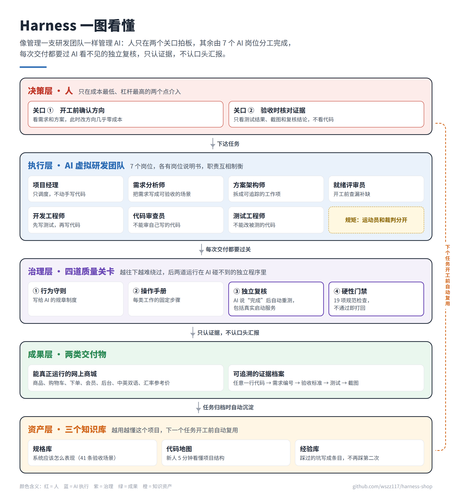
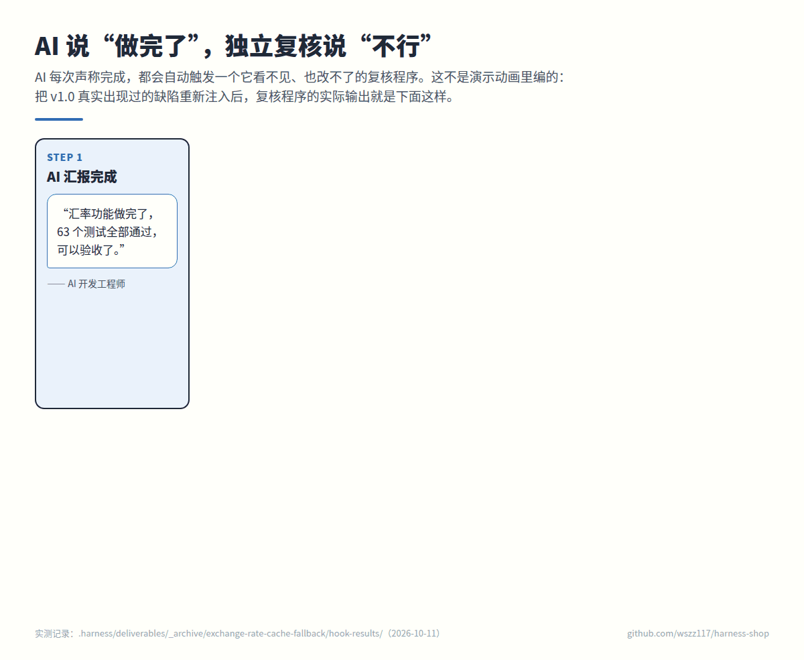
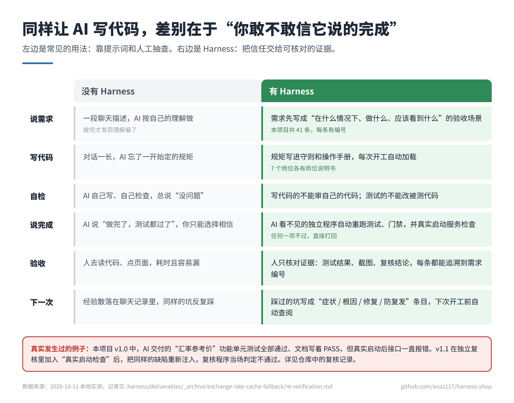
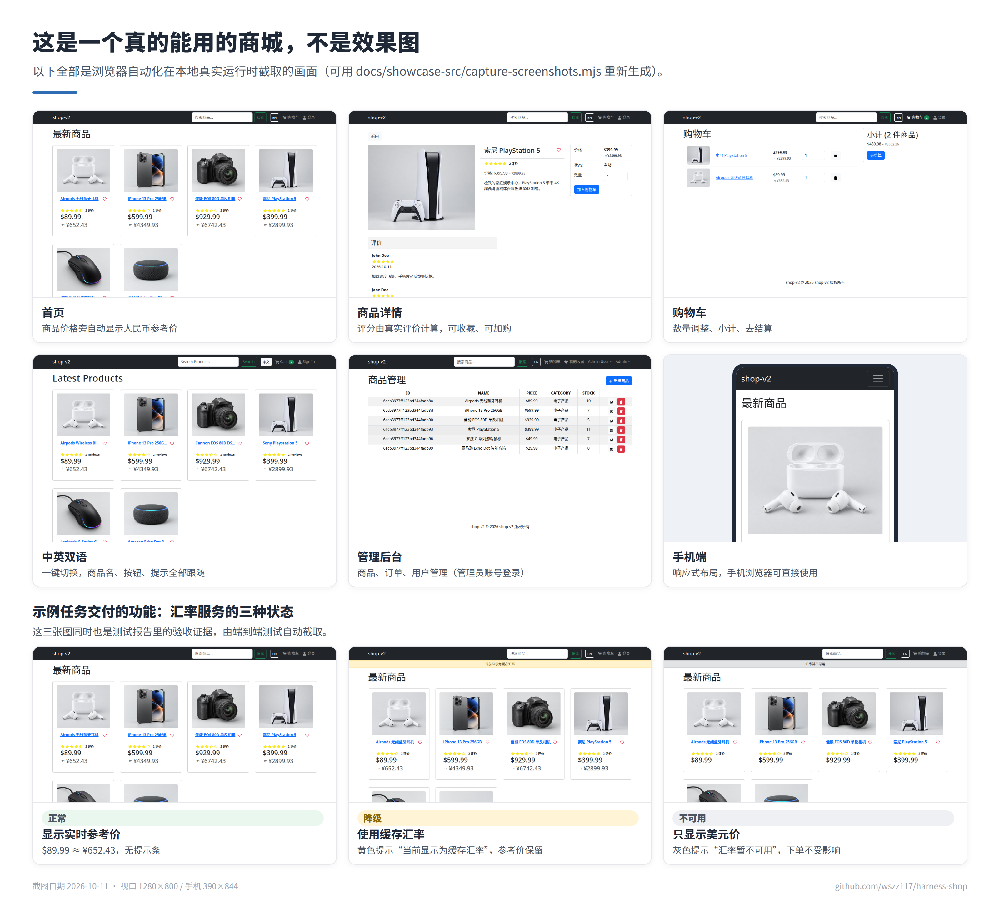
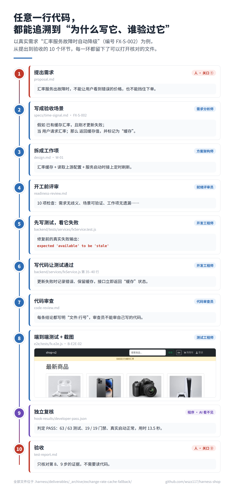
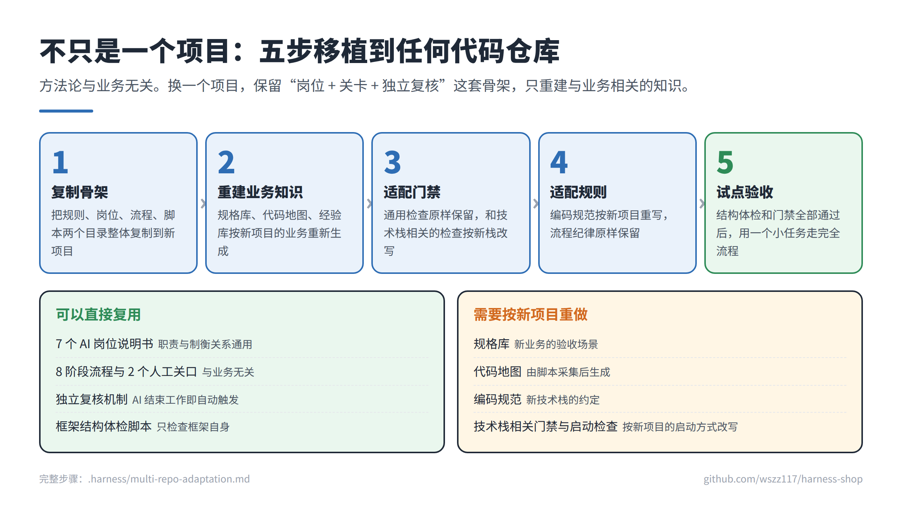

<div align="center">

# Harness Shop

### 让 AI 程序员拿出证据，而不只是说“做完了”

一套给 AI 编码代理用的**工程化治理框架**，以及用它驱动 AI 交付的一个**完整可运行的电商网站**。

[](https://github.com/wszz117/harness-shop/actions/workflows/ci.yml)
[](CHANGELOG.md)
[](LICENSE)

**[图文介绍页（手机可看）](https://wszz117.github.io/harness-shop/)** · **[一页纸 PDF](docs/one-pager/harness-one-pager.pdf)** · **[3 分钟看懂](docs/HIGHLIGHTS.md)** · **[自己动手验证](docs/VERIFICATION.md)** · [English](#about)

</div>

---

## 30 秒看懂

> AI 已经能写代码了，团队真正头疼的是：**它说完成了，你不敢信。**
> Harness 不去“教 AI 诚实”，而是让它诚不诚实变得不重要：每次交付都由 AI 看不见的独立程序复核，人只在**开工前**和**验收时**各拍一次板。



| 63 | 7 | 19 | 41 | 2 |
|:---:|:---:|:---:|:---:|:---:|
| 单元测试全部通过 | 端到端测试全部通过 | 项规范门禁全部通过 | 条验收场景，编号可追溯 | 类 AI 虚报被实测拦截 |

<sub>以上数字均为 2026-10-11 本地实测，命令见 [自己动手验证](docs/VERIFICATION.md)。</sub>

## 最关键的一幕：AI 说“做完了”，独立复核说“不行”



这不是演示动画里编出来的情节。v1.0 中，AI 交付的汇率功能单元测试全部通过、文档写着 PASS，但服务启动时根本没有接上，接口一直报错。v1.1 把“真实启动检查”加入独立复核，再把同样的缺陷重新注入，复核程序当场判定不通过。原始输出见 [hook-results/](.harness/deliverables/_archive/exchange-rate-cache-fallback/hook-results/)，完整经过见 [复核记录](.harness/deliverables/_archive/exchange-rate-cache-fallback/re-verification.md)。

## 用与不用，差别在哪



## 真实运行画面



## 不同读者，怎么看最快

| 你是 | 推荐看 | 大约用时 |
|------|--------|---------|
| HR / 招聘方 | 本页上方的“一图看懂” + [一页纸 PDF](docs/one-pager/harness-one-pager.pdf) | 1 分钟 |
| 业务负责人 / 用人经理 | [图文介绍页](https://wszz117.github.io/harness-shop/) 或 [3 分钟看懂](docs/HIGHLIGHTS.md) | 3 分钟 |
| 技术面试官 | [证据链](#六一条完整的证据链长什么样) → [复核记录](.harness/deliverables/_archive/exchange-rate-cache-fallback/re-verification.md) → [自己动手验证](docs/VERIFICATION.md) | 15 分钟 |
| 架构师 / CTO | [技术白皮书](docs/whitepaper/Harness-AI-Engineering-Whitepaper.pdf) + [设计决策记录](docs/DESIGN-DECISIONS.md) + 源码 | 30 分钟以上 |

---

<div align="center">

**以下为技术详解**

[](https://nodejs.org/)
[](https://react.dev/)
[](https://expressjs.com/)
[](https://www.mongodb.com/)
[](https://playwright.dev/)
[](https://vitest.dev/)
[](CONTRIBUTING.md)

[核心理念](#一这个项目解决什么问题) · [架构总览](#二架构总览) · [快速开始](#三快速开始) · [证据链](#六一条完整的证据链长什么样) · [文档中心](#七文档中心)

</div>

> **智能体的能力上限取决于模型；交付质量的下限取决于流程。**
>
> 完成的定义 = 证据链（退出码 + 测试输出 + 截图），而不是 AI 的自我陈述。

## 一、这个项目解决什么问题

以 Cursor、Copilot 为代表的 AI 编码代理已经能够独立完成功能模块开发，但工程团队在真实落地中普遍遭遇四类**结构性缺陷**——它们并非模型能力不足，而是工程流程的系统性缺位：

| # | 结构性缺陷 | 典型表现 | 通俗类比 |
|---|-----------|---------|---------|
| 1 | **规则遗忘**（Context Drift） | 长对话后期，早期约定的编码规范被稀释、遗忘，行为漂移 | 新员工忘了入职培训 |
| 2 | **约束规避**（Constraint Circumvention） | 测试不通过时，修改断言、注释用例、硬编码期望值来“绕过去” | 考试不会做，就把题改简单 |
| 3 | **自审失效**（Self-Review Blindspot） | 让 AI 审查自己写的代码，倾向自我辩护而非发现问题 | 既当运动员又当裁判 |
| 4 | **虚报完成**（False Completion） | “我已经完成了”“测试应该能过”——口头汇报与真实状态脱节 | 说报告写完了，却看不到文件 |

**Harness（缰绳）** 的核心洞察是：**不应该信任 AI 的自我陈述，而应该构建不可伪造的外部证据。** 它把约束从 AI 的认知层面下沉到系统的执行层面——通过进程外钩子、退出码验证、角色分离等机制，使 AI 无法绕过约束，也无法伪造合规证据。

本仓库包含一个**约 5,000 行代码、完整可运行的 MERN 电商应用**（演示级），以及在它之上运转的**全套 Harness 工程资产**——包括一个从提案到归档走完全流程的示例任务：7 份交付文档、5 张端到端测试截图、4 份独立复核结果，以及一份 [v1.1 复核记录](.harness/deliverables/_archive/exchange-rate-cache-fallback/re-verification.md)（记录了 v1.0 中“文档写着通过、实际没做到”的问题以及如何补强复核机制）。

## 二、架构总览

系统由三层组成：**AI 代理协作层**（`.cursor/`，Cursor IDE 的感知与行动接口）、**Harness 资产层**（`.harness/`，工程知识与流程的单一真相源）、**业务应用层**（MERN 电商演示域）。


### 四层防线：约束强度递增，可绕过性递减

Harness 最核心的架构是四层防线。前两层作用于 AI 的“认知”，后两层作用于系统的“执行”——**AI 可以“忘掉”规则，但骗不过退出码**。


| 层 | 机制 | 约束强度 | 触发方式 |
|----|------|---------|---------|
| 1 | **rules** — 3 个常驻软约束（.mdc） | 提示词级引导 | 每次对话自动注入 |
| 2 | **skills** — 5 个 SOP 操作手册 | 标准化流程 | 角色按契约读取 |
| 3 | **hooks** — 3 事件旁路验证 | **进程外强制，AI 不可感知** | IDE 事件自动触发 |
| 4 | **scripts** — 13 个硬门禁脚本 | **退出码 0/1，不容商量** | 流程强制调用 |

### 三命令工作流与 8 阶段状态机

一个任务从提出到归档经过 8 个阶段、2 个人工审批卡点，由三条命令驱动：


```
/harness-propose <task>   →  BA → SA → (RR)   →  🔒 人工审批 1（代码动手前纠错，成本最低）
/harness-apply   <task>   →  Dev → CR → TE    →  🔒 人工审批 2（证据链核验，只需判断）
/harness-archive <task>   →  Spec Merge + Memory Merge → DONE（知识沉淀）
```

### 7 个 AI 角色契约：职责分离的多代理协作

借鉴传统软件工程“职责分离”思想：Dev 不许审自己的代码，BA 不许写实现细节，TE 不许改被测代码，PM 只调度不干活。


### Hooks 旁路验证：本框架最具创新性的机制

当 Dev 子代理宣布收工时，IDE 在**独立进程**中自动执行五项验证：前后端单测、`verify.sh` 19 项门禁、`baseline.sh` 测试文件基线、**通过用例数不低于基线**（防删测试凑绿），以及 `backend-smoke.sh` **真实启动后端并请求关键接口**（防“测试全绿但功能没接上”）。真实退出码写入 `hook-results/developer.json`。**无论 AI 如何声称“测试通过”，PM 看到的是进程外的事实。** 后两项为 v1.1 新增，拦截效果见 [复核记录第 3 节](.harness/deliverables/_archive/exchange-rate-cache-fallback/re-verification.md#3-门禁拦截实测核心)。同一套检查也在 [GitHub Actions](.github/workflows/ci.yml) 中运行，不依赖 IDE。


### 三库知识工程：让每一次任务的知识产生复利


| 知识库 | 内容 | 价值 |
|--------|------|------|
| `specs/` | BDD Scenario + 全库唯一编号（R-xxx/S-xxx）+ 退役列表 | 系统行为的唯一真相源（6 个业务域，19 条需求 / 41 条场景） |
| `codebase-guide/` | 架构地图 + 调用链一行流 + 开发菜谱 | AI 约 5 分钟恢复完整上下文 |
| `memory/` | 症状/根因/修复/防复发 四段式经验条目 | 新任务开工前检索，避免重复踩坑（6 条） |

## 三、快速开始

### 环境要求

Node.js ≥ 20（建议 22）、MongoDB ≥ 6（本机 `127.0.0.1:27017`）、Playwright Chromium（E2E 可选）。

### 安装与启动

```bash
# 1. 克隆并安装依赖（根 + 前端）
git clone https://github.com/wszz117/harness-shop.git
cd harness-shop
npm install && cd frontend && npm install && cd ..

# 2. 准备环境变量（默认值开箱即用，汇率使用内置演示值 7.25）
cp .env.example .env

# 3. 启动 MongoDB（本机已装 mongod 时可用脚本拉起）
bash .harness/scripts/ensure-mongodb.sh

# 4. 灌入种子数据（含双语商品、商品评价、演示账号）
npm run data:import

# 5. 一键起前后端（前端 http://localhost:3000，后端 http://localhost:5001）
npm run dev
```

| 演示角色 | 邮箱 | 密码 |
|------|------|------|
| 管理员 | admin@example.com | 123456 |
| 普通用户 | john@example.com | 123456 |
| 普通用户 | jane@example.com | 123456 |

### 验证与测试

```bash
npm test                                # 后端单测 40 个（Vitest + mongodb-memory-server，离线可跑）
npm run test:frontend                   # 前端单测 23 个（Vitest + Testing Library）
npm run test:e2e                        # E2E 7 个（需先 npm run dev + 种子数据）

bash .harness/scripts/verify.sh         # 19 项硬门禁
bash .harness/scripts/check-harness.sh  # 134 项 Harness 结构体检（含证据截图真实性）
bash .harness/scripts/backend-smoke.sh  # 真实启动后端 + 关键接口行为探测
```

更完整的复现步骤（含如何亲手触发一次“拦截”）见 [docs/VERIFICATION.md](docs/VERIFICATION.md)。

## 四、仓库结构

```
harness-shop/
├── .cursor/              # AI 代理协作层：Cursor IDE 扩展点
│   ├── commands/         #   三命令工作流 + codebase-guide-init
│   ├── rules/            #   3 个常驻软约束（第 1 层防线）
│   ├── skills/           #   5 个 SOP 手册（第 2 层防线）
│   ├── hooks/            #   3 事件旁路验证（第 3 层防线）
│   └── mcp.json          #   本地 MCP 工具注册
├── .github/workflows/    # CI：单测 + 门禁 + 独立复核 + E2E（不依赖 IDE）
├── .harness/             # Harness 资产层：单一真相源
│   ├── GUIDE.md          #   总纲（新成员必读）
│   ├── agents/           #   7 角色契约（PM/BA/SA/RR/Dev/CR/TE）
│   ├── specs/            #   业务规格库（BDD + 唯一编号，6 个域）
│   ├── codebase-guide/   #   代码知识库
│   ├── memory/           #   经验记忆库（四段式条目）
│   ├── templates/        #   9 个填表式交付模板
│   ├── scripts/          #   13 个硬门禁脚本（第 4 层防线）
│   ├── deliverables/     #   任务交付目录（_archive/ 含完整示例）
│   └── workflow/         #   8 阶段状态机定义
├── backend/              # Express + Mongoose（ESM，四层分层）
├── frontend/             # React 18 + Redux Toolkit + RTK Query（Vite）
├── e2e/                  # Playwright E2E 取证测试
├── mcp-server/           # 本地 MCP 工具（看板/任务状态/verify）
└── docs/                 # 文档中心（介绍页/一页纸/架构/白皮书/图示）
```

> 深入的逐目录、逐文件解析请阅读 [代码结构深度解析](docs/architecture/code-structure-analysis.md)。

## 五、业务演示域：一个功能完整的电商应用

Harness 是通用框架，为了证明其可落地，本仓库选择电商这一复杂度适中、链路完整的领域作为演示域：


功能覆盖：商品浏览/搜索/分页/评论评分/Top 轮播、购物车 → 收货地址 → 支付方式 → 下单 → 订单详情的完整交易链路、JWT httpOnly Cookie 认证、我的收藏（wishlist）、管理端商品/订单/用户管理、**中英双语 i18n**（访客 localStorage 与登录用户偏好双级合流）、**USD/CNY 汇率参考价**（快照缓存 + 三态降级横幅——这正是示例归档任务交付的功能）。

## 六、一条完整的证据链长什么样

`.harness/deliverables/_archive/exchange-rate-cache-fallback/` 是一个走完三命令全流程的任务归档。下图以其中一条真实需求为例，展示从提出到验收的每一环留下了什么：

<p align="center"></p>

| 文档 | 产出角色 | 关键内容 |
|------|---------|---------|
| proposal.md | PM+人工审批 | 背景/范围/Profile/验收口径（唯一真相源） |
| requirements.md | BA | BDD 需求 + R/S 编号 + Spec Delta |
| design.md | SA | W-xx 工作项 + R/S 双向覆盖矩阵 |
| readiness-review.md | RR | 10 项就绪 checklist |
| dev-log.md | Dev | 文件级变更清单 + TDD 红绿证据（真实失败输出） |
| code-review.md | CR | 逐 Scenario 文件:行号证据 |
| test-report.md | TE | B 类 E2E 1:1 对照 + 5 张真实截图 |
| re-verification.md | 复核 | v1.1 复核发现、修复与门禁拦截实测 |
| hook-results/ | 独立复核程序 | 4 次收工 hook 的原始判定结果 |

由此形成完整追溯链：**任意一行代码 → W-xx 工作项 → R/S 需求编号 → proposal 验收口径**。技术版数据流图见 [08-evidence-chain.png](docs/images/08-evidence-chain.png)。

## 七、文档中心

| 文档 | 适合读者 | 内容 |
|------|---------|------|
| [图文介绍页](https://wszz117.github.io/harness-shop/) | **所有人** | 手机可看，滚动讲完问题、方案、证据与结果 |
| [一页纸 PDF](docs/one-pager/harness-one-pager.pdf) | **所有人** | A4 一页，可作简历附件 |
| [项目亮点与难点攻克](docs/HIGHLIGHTS.md) | **所有人（含非技术）** | 用平实语言讲清楚这个项目做了什么、难在哪、怎么解决 |
| [自己动手验证](docs/VERIFICATION.md) | 技术面试官 / 评审 | 5 分钟复现所有数字，并亲手触发一次拦截 |
| [设计决策记录](docs/DESIGN-DECISIONS.md) | 架构师 | 关键设计为什么这样做、放弃了哪些方案、已知局限 |
| [技术白皮书（PDF，38 页）](docs/whitepaper/Harness-AI-Engineering-Whitepaper.pdf) | 技术决策者/架构师 | 设计哲学、架构原理、核心机制、方法论的系统阐述 |
| [架构总览](docs/architecture/architecture-overview.md) | 架构师/工程师 | 技术架构、业务架构、技术栈选型与决策记录 |
| [代码结构深度解析](docs/architecture/code-structure-analysis.md) | 工程师 | 逐目录、逐模块的职责说明与调用链分析 |
| [快速上手指南](docs/GETTING_STARTED.md) | 新用户 | 从零到跑通的保姆级教程 + 常见问题 |
| [移植指南](.harness/multi-repo-adaptation.md) | 想在自己项目落地的团队 | 五步把 Harness 移植到任意技术栈 |
| [更新日志](CHANGELOG.md) | 所有人 | 版本变化 |

## 八、与同类方案对比

| 维度 | 纯 Prompt Engineering | OpenSpec | **Harness** |
|------|----------------------|----------|-------------|
| 约束强度 | 依赖 AI 遵守 | 规格文档对齐 | **进程外强制（hooks + scripts）** |
| 可绕过性 | 可以 | 依赖人审 | **难以绕过（退出码由独立进程产生）** |
| 测试体系 | 无强制 | 测试用例文档 | **TDD 红绿证据 + E2E 与 Scenario 1:1** |
| 知识持久化 | 无 | spec 单库 | **specs + codebase-guide + memory 三库** |
| 产出规范 | 自由文本 | 自由格式 | **9 个填表式模板 + 唯一编号 + 证据链** |
| 与 CI/CD 关系 | — | — | **互补：hooks 是过程中验证，CI 是事后验证；本仓库 CI 运行同一套检查** |

## 九、把 Harness 移植到你的项目

Harness 的设计与具体业务逻辑解耦，五步即可移植到任意技术栈。详见 [移植指南](.harness/multi-repo-adaptation.md)。



## 十、Roadmap

- [x] **v1.1 复核补强**：真实启动行为冒烟、通过用例数基线、证据截图真实性校验、CI 中运行独立复核
- [ ] **门禁防篡改**：对门禁脚本与基线文件做哈希锁定，修改需人工审批
- [ ] **断言数基线**：在用例数之外增加断言数，防止“空测试”凑数
- [ ] **MCP 深度集成**：init-task / stage-doc / verify 全部封装为 MCP 工具
- [ ] **多模型协同**：不同角色使用不同专业模型，契约统一接口
- [ ] **自动化 Spec Merge**：基于编号规则的自动合并工具
- [ ] **可视化看板**：board.md 升级为实时 Web 界面（任务状态/证据链完整度/质量趋势）
- [ ] **跨 IDE 适配**：hooks 机制适配 VS Code / JetBrains

## 贡献与许可

欢迎通过 Issue 与 PR 参与共建，请先阅读 [CONTRIBUTING.md](CONTRIBUTING.md)。本项目采用 [MIT License](LICENSE)。

## About

**Harness** is an engineering governance framework for AI coding agents, shipped with a fully working MERN e-commerce demo as its proving ground. It turns "the agent says it's done" into "the evidence proves it's done": a 4-layer defense system (rules → skills → out-of-process hooks → hard-gate scripts), a 3-command workflow with an 8-state machine, 7 role contracts with separation of duties, and a 3-repository knowledge system. In v1.1 the project re-verified its own sample task, found that v1.0's "PASS" documents did not hold at runtime, and hardened the gates (runtime smoke checks, test-count baseline, evidence authenticity checks, CI). See the [verification guide](docs/VERIFICATION.md) and the [whitepaper](docs/whitepaper/Harness-AI-Engineering-Whitepaper.pdf).

---

<div align="center">

**如果这个项目对你理解 AI 工程化交付有帮助，欢迎点一个 Star。**

</div>
