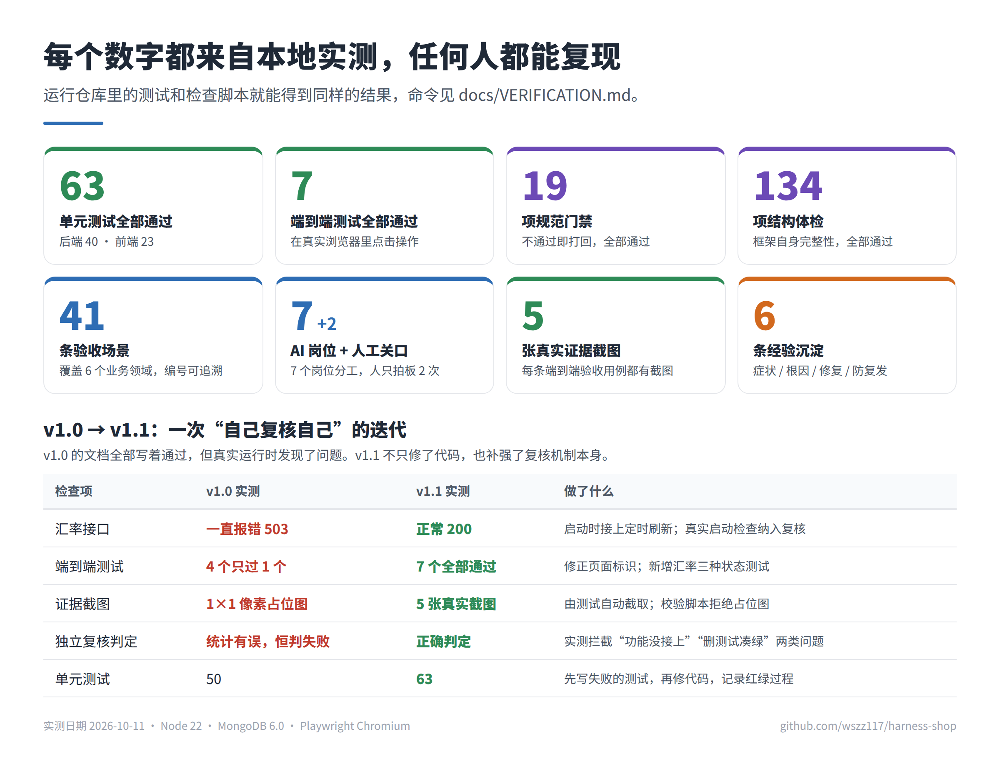

# 自己动手验证

> 写给技术面试官、评审者和任何想确认“这些数字是不是真的”的读者。所有步骤都在本地完成，不需要 Cursor，也不需要任何账号。



## 0. 准备（约 3 分钟）

需要 Node.js ≥ 20、Python 3、MongoDB ≥ 6（本机 27017）。

```bash
git clone https://github.com/wszz117/harness-shop.git && cd harness-shop
npm ci && npm ci --prefix frontend
cp .env.example .env
```

不想装 MongoDB 的话，第 1 步的单测、门禁、体检都可以离线运行（后端单测使用内存数据库）；只有第 2、3 步需要本机数据库。

## 1. 复现看板上的数字（约 2 分钟）

| 命令 | 期望输出（最后一行） | 对应数字 |
|------|---------------------|---------|
| `npm test` | `Tests  40 passed (40)` | 后端单测 40 |
| `npm run test:frontend` | `Tests  23 passed (23)` | 前端单测 23 |
| `bash .harness/scripts/verify.sh` | `[VERIFY PASS] 全部 19 项通过` | 规范门禁 19 |
| `bash .harness/scripts/check-harness.sh` | `[CHECK-HARNESS PASS] 全部 134 项通过` | 结构体检 134 |
| `python3 .harness/scripts/spec-lint.py` | `[SPEC-LINT PASS] 60 个编号唯一，格式合规` | 需求 19 + 验收场景 41 |
| `python3 .harness/scripts/check-e2e-evidence.py check-archived-all` | `5 张证据截图全部存在且为真实截图` | 证据截图 5 |

## 2. 亲手运行一次独立复核（约 1 分钟）

这就是 Cursor 里 AI 开发工程师宣布“收工”时自动触发的那个程序。在终端里手动触发，效果完全相同：

```bash
bash .harness/scripts/ensure-mongodb.sh          # 后端真实启动检查需要数据库
echo '{"subagent_type":"developer","prompt":"TASK_NAME=try-it"}' \
  | python3 .cursor/hooks/dispatch-subagent.py > /dev/null
cat .harness/.hook-results/try-it/developer.json
```

期望看到 `"verdict": "PASS"`、`"test_counts": {"passed": 63, "failed": 0}`、`"smoke_rc": 0`。

## 3. 亲手触发一次“拦截”（约 2 分钟）

### 场景 A：测试全过，但功能没接上

把 v1.0 中真实出现过的缺陷放回去——注释掉服务启动时的汇率接线：

```bash
sed -i 's|^fxService.startAutoRefresh();|// fxService.startAutoRefresh();|' backend/server.js
npm test 2>&1 | grep "Tests "        # 单测依然全部通过：Tests 40 passed (40)
echo '{"subagent_type":"developer","prompt":"TASK_NAME=try-a"}' \
  | python3 .cursor/hooks/dispatch-subagent.py > /dev/null
grep -E '"verdict"|"fail_reason"' .harness/.hook-results/try-a/developer.json
git checkout backend/server.js       # 还原
```

期望：`"verdict": "FAIL"`，`"fail_reason": "后端行为冒烟未过(rc=1)"`。单测和门禁都是绿的，只有“真实启动后去调接口”这一步发现了问题。

### 场景 B：删测试凑绿

```bash
mv backend/tests/services/fxService.test.js /tmp/
echo '{"subagent_type":"developer","prompt":"TASK_NAME=try-b"}' \
  | python3 .cursor/hooks/dispatch-subagent.py > /dev/null
grep -E '"verdict"|"fail_reason"' .harness/.hook-results/try-b/developer.json
mv /tmp/fxService.test.js backend/tests/services/   # 还原
```

期望：`"verdict": "FAIL"`，`"fail_reason"` 中包含“通过用例数 50 低于基线 63”。

我们自己运行这两个场景得到的原始结果，保存在 [hook-results/](../.harness/deliverables/_archive/exchange-rate-cache-fallback/hook-results/)。

## 4. 端到端测试与证据截图（约 2 分钟）

```bash
npm run data:import
npm run dev                          # 另开一个终端保持运行
npx playwright install chromium      # 首次需要
E2E_EVIDENCE_DIR=/tmp/my-evidence npx playwright test -c e2e/playwright.config.js
ls -la /tmp/my-evidence              # 新生成的证据截图
```

期望：`7 passed`。`/tmp/my-evidence` 下会生成与 [归档证据](../.harness/deliverables/_archive/exchange-rate-cache-fallback/evidence/) 同名的截图，可以直接对比。

## 5. CI 中的同一套检查

[`.github/workflows/ci.yml`](../.github/workflows/ci.yml) 在每次提交时，在 GitHub 的干净环境里重新执行第 1、2、4 步，并把端到端证据截图作为构建产物上传。打开仓库的 Actions 页即可查看每次运行的日志与截图。

## 6. 已知局限（坦白说）

| 局限 | 现状 | 计划 |
|------|------|------|
| 门禁脚本本身没有防篡改 | 依靠角色分离（开发不能改门禁）与代码审查约束 | 对门禁脚本与基线文件做哈希锁定，修改需人工审批 |
| 基线只比较测试文件数与通过用例数 | 能拦截删测试，但拦不住“空断言”测试 | 增加断言数基线 |
| 收工 hook 依赖 Cursor 的事件 | 其他 IDE 中需手动触发；CI 已运行同一套检查 | 适配 VS Code / JetBrains |
| 示例任务只有一个 | 方法论的效果数据样本量小 | 持续用更多任务积累对照数据 |
