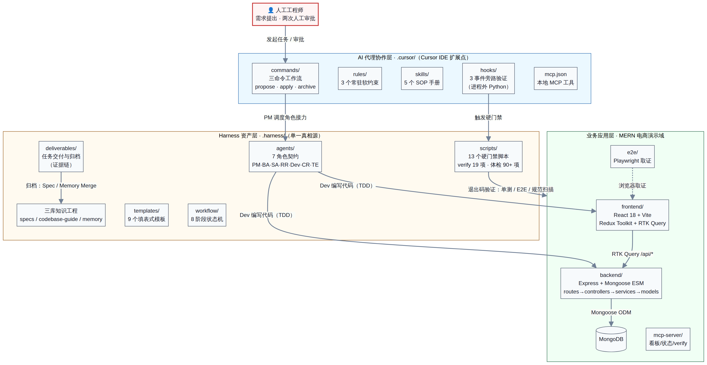
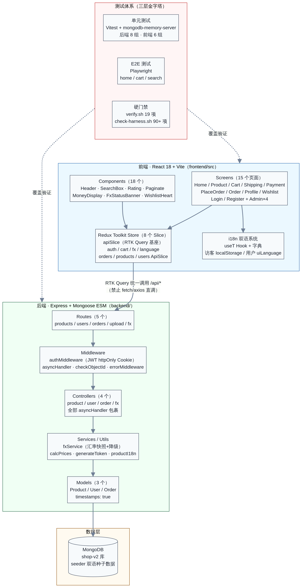
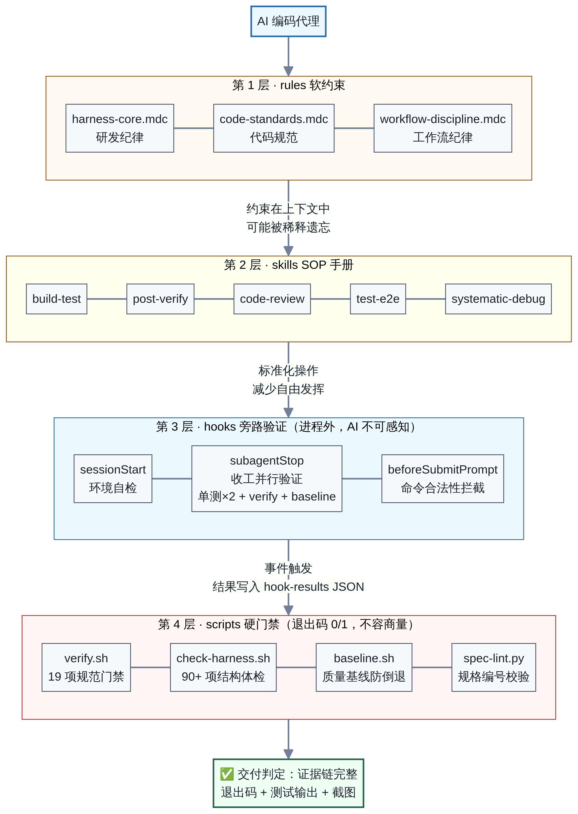
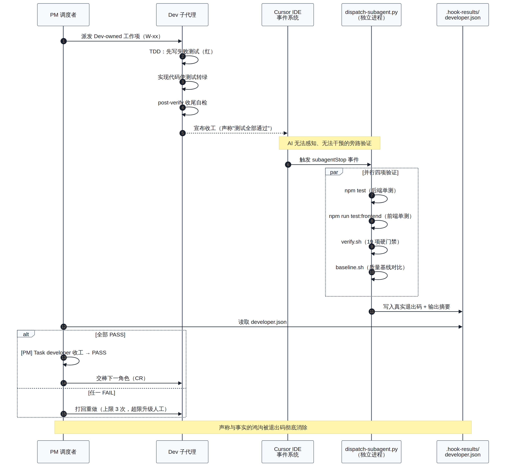
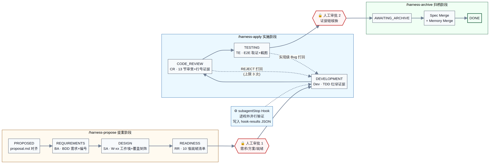
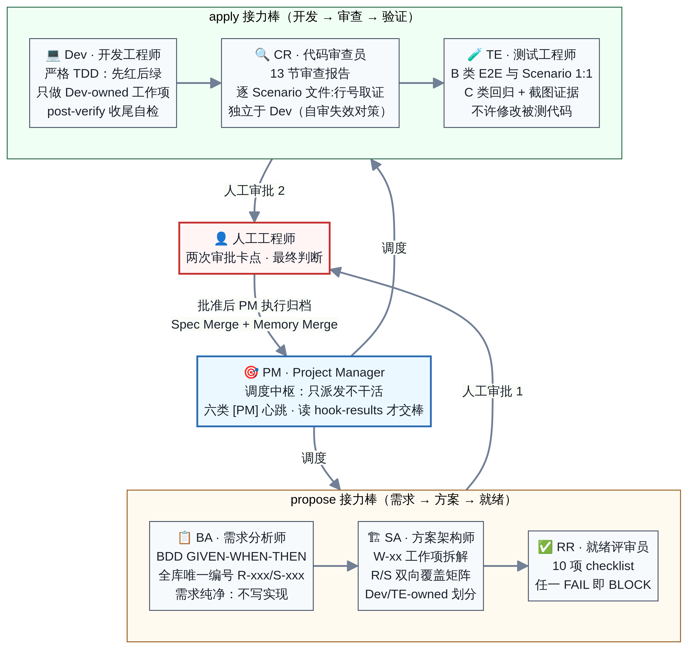
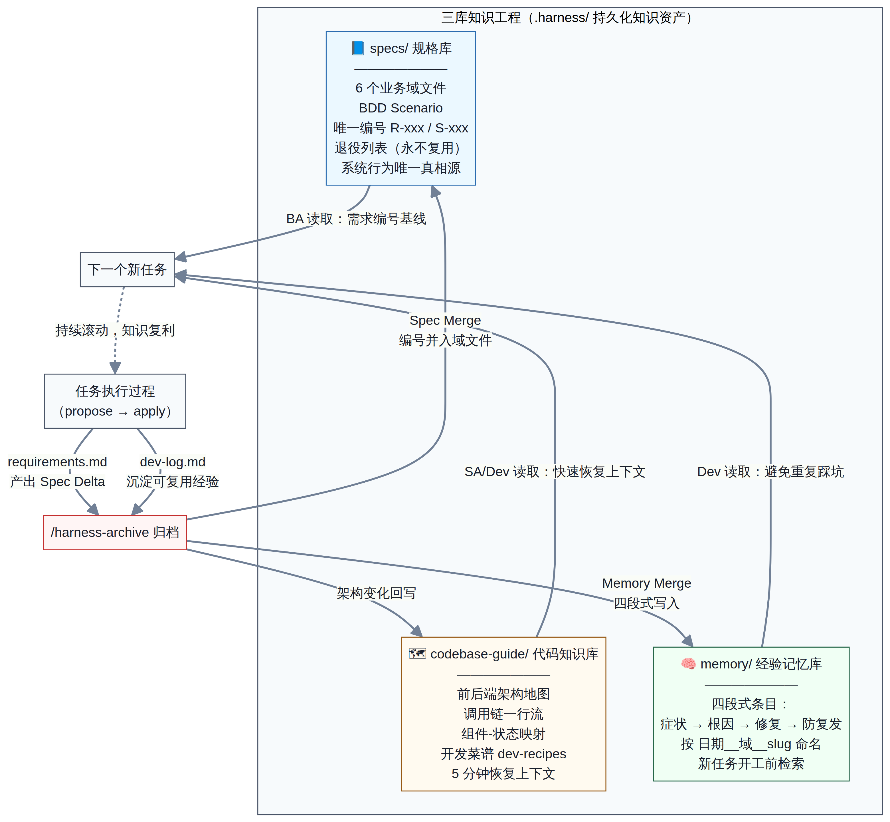
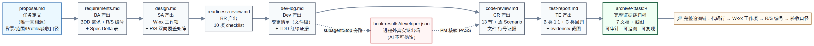

# 架构总览（Architecture Overview）

> 本文从架构师视角系统阐述 Harness Shop 的**技术架构**、**业务架构**与**技术栈选型**。阅读本文前建议先浏览 [主 README](../../README.md) 建立整体印象；需要理论深度的读者请参阅 [技术白皮书](../whitepaper/Harness-AI-Engineering-Whitepaper.pdf)。

## 1. 架构设计的出发点

本项目本质上是**两个系统的叠加**：一个是面向最终用户的 MERN 电商应用（业务系统），另一个是面向 AI 编码代理的工程化约束框架 Harness（元系统）。架构设计的核心命题是：**如何让元系统在不侵入业务代码的前提下，对业务系统的每一次变更施加不可绕过的质量约束。**

由此推导出三条顶层设计原则：

| 原则 | 含义 | 落地形态 |
|------|------|---------|
| **关注点分离** | 框架资产与业务代码物理隔离 | `.cursor/` + `.harness/` 两个独立目录，业务代码零侵入 |
| **不信任而验证** | 不信任 AI 的自我陈述，只认外部证据 | 进程外 hooks + 退出码硬门禁 + 截图证据链 |
| **知识资产化** | 每次任务的产出必须沉淀为可复用资产 | specs / codebase-guide / memory 三库滚动更新 |

## 2. 总体技术架构

系统自顶向下分为三层，人工工程师位于最顶端，掌握两次审批卡点的最终判断权：

### 2.1 AI 代理协作层（`.cursor/`）

这一层是 Harness 与 Cursor IDE 的**接口适配层**，利用 IDE 提供的四类扩展点把框架"接入" AI 的感知与行动回路：

| 扩展点 | 数量 | 职责 | 防线层级 |
|--------|------|------|---------|
| `commands/` | 4 | 三命令工作流入口（propose/apply/archive）+ codebase-guide-init | 流程入口 |
| `rules/` | 3 | 常驻软约束：研发纪律、代码规范、工作流纪律 | 第 1 层 |
| `skills/` | 5 | SOP 手册：build-test、post-verify、code-review、test-e2e、systematic-debug | 第 2 层 |
| `hooks/` + `hooks.json` | 3 事件 | sessionStart / subagentStop / beforeSubmitPrompt 旁路验证 | 第 3 层 |
| `mcp.json` | 1 | 注册本地 MCP 工具（看板查询、任务状态、verify 执行） | 工具扩展 |

架构上的关键决策是：**这一层只做"薄适配"**。所有实质性知识（角色契约、模板、规格）都存放在 `.harness/`，`.cursor/` 中的命令与规则只负责引用和触发。这使得未来适配 VS Code、JetBrains 等其他 IDE 时，只需重写这一薄层。

### 2.2 Harness 资产层（`.harness/`）

这是整个框架的**单一真相源（Single Source of Truth）**，可以进一步划分为四个子系统：

**流程子系统**（workflow/ + agents/ + templates/）：`transitions.json` 定义了 9 个状态、3 种流程档位（Profile）、2 个人工卡点和 4 条回退规则的完整状态机；7 份角色契约以"输入 → 职责 → 产出 → 禁区"四要素定义每个 AI 角色的行为边界；9 个填表式模板保证交付文档结构统一、机器可校验。

**门禁子系统**（scripts/）：13 个脚本构成第 4 层防线，全部以退出码作为唯一裁决依据。核心是 `verify.sh`（19 项工程规范门禁，如单文件 ≤300 行、禁止 console.log、controllers 必须 asyncHandler 包裹、前端禁止绕过 RTK Query 直调 fetch/axios 等）和 `check-harness.sh`（90+ 项框架结构完整性体检）。`baseline.sh` 记录并对比质量基线，防止"改好一处、退化三处"。

**知识子系统**（specs/ + codebase-guide/ + memory/）：三库分别承载"系统应该做什么"（BDD 规格 + 全库唯一编号）、"代码实际怎么组织"（架构地图 + 调用链一行流）、"过去踩过什么坑"（四段式经验条目）。详见第 5 节。

**交付子系统**（deliverables/ + tasks/）：每个任务拥有独立交付目录，7 份标准文档 + 证据附件构成完整证据链；`board.md` 是全局任务看板；归档任务进入 `_archive/` 永久留存。

### 2.3 业务应用层（MERN 电商）

业务层采用经典的前后端分离架构，后端为四层分层（routes → middleware → controllers → services/models），前端以 Redux Toolkit + RTK Query 为数据主干：

后端关键约束（全部由 verify.sh 硬性保证，而非口头约定）：`server.js` 只负责 listen，应用装配在 `app.js`（保证 supertest 可测性）；所有 controller 必须以 `asyncHandler` 包裹（统一异常出口）；所有 model 必须开启 `timestamps: true`；路由必须全部挂载于 `app.js`。

前端关键约束：所有服务端交互必须经过 RTK Query（`apiSlice` 基座 + 领域 ApiSlice 注入），禁止组件内 fetch/axios 直调；禁止内联 style；每个 Screen 必须在路由表注册。这些约束使 AI 生成的代码天然保持一致的架构风格。

## 3. 四层防线：本框架的核心架构机制

四层防线的设计逻辑是**约束强度递增、可绕过性递减**。第 1-2 层（rules/skills）作用于 AI 的认知层面——它们可能随上下文变长而被稀释；第 3-4 层（hooks/scripts）作用于系统执行层面——hooks 在 AI 进程之外运行，AI 既无法感知也无法干预，scripts 以退出码 0/1 裁决，不存在"商量"的空间。

其中 **hooks 旁路验证**是最具创新性的一环。当 Dev 子代理宣布收工时，`subagentStop` 事件在独立进程中自动并行执行四项验证（后端单测、前端单测、verify.sh、baseline.sh），并将真实退出码写入 `.harness/.hook-results/<task>/developer.json`。PM 角色被契约强制要求"读到 PASS 才能交棒"——**声称与事实之间的鸿沟被退出码彻底消除**：

## 4. 业务架构：流程视角

### 4.1 研发业务流：三命令、8 阶段、2 卡点

整个研发流程被建模为一个显式状态机（`workflow/transitions.json`）。两个人工卡点的位置经过精心设计：**审批 1** 位于代码动手之前（此时纠错成本最低，审批者只需要读 BDD 需求和工作项拆解）；**审批 2** 位于归档之前（此时审批者面对的是完整证据链，只需做判断题而非阅读题）。状态机还定义了 4 条回退规则：CR 审查 REJECT 回退 DEVELOPMENT（上限 3 次，超限升级人工）、TE 发现实现级缺陷回退 DEVELOPMENT、需求级缺陷回退 REQUIREMENTS、环境阻塞升级 HUMAN_ESCALATION。

三种流程档位（Profile）在 proposal.md 中勾选，实现了"重流程"与"轻任务"的平衡：

| Profile | 适用场景 | propose 阶段棒次 | 差异 |
|---------|---------|-----------------|------|
| quick | 文案修改、小缺陷修复 | BA → SA | SA 文末就绪自评，跳过 RR |
| standard | 默认档位，新功能开发 | BA → SA → RR | 完整三棒 |
| refactor | 跨模块重构 | SA 影响面预扫描 → BA → SA → RR | 前置 impact-analysis |

### 4.2 角色协作架构：7 个 AI 角色的职责分离

角色设计直接针对"自审失效"缺陷：**产出者与审查者必须是不同的角色实例**。PM 作为调度中枢"只派发不干活"，以六类标准化心跳（Profile 识别、文档就位、Task 开工、脚本事件、Task 收工、异常告警）向人工审批者汇报进度；BA 的需求文档"纯净无实现"；Dev 只做 Dev-owned 工作项；CR 独立取证审查（13 节报告、逐 Scenario 给出文件:行号证据）；TE 的 E2E 用例与 BDD Scenario 保持 1:1 对照且禁止修改被测代码。

### 4.3 电商演示域的业务功能架构

业务功能划分为六个规格域（specs/ 目录与之一一对应）：

| 规格域 | 覆盖功能 | 代表性技术点 |
|--------|---------|-------------|
| products | 商品列表/详情/搜索/分页/评论/Top 轮播 | 关键词正则搜索 + 服务端分页 |
| orders | 购物车 → 地址 → 支付 → 下单 → 订单详情 | 服务端价格重算（防篡改）+ 汇率参考价 |
| user-auth | 注册/登录/资料/管理端用户管理 | JWT httpOnly Cookie + 角色鉴权中间件 |
| wishlist | 收藏红心/收藏页/空态 | 乐观更新 + 缓存失效 |
| i18n | 中英双语 | 访客 localStorage 与用户 uiLanguage 双级合流 |
| time-signal | 汇率快照与降级 | 快照缓存 + 三态横幅（fresh/stale/unavailable） |

## 5. 知识工程架构

三库知识工程解决的是 AI 协作中最隐蔽的损耗——**上下文与经验的挥发**。specs/ 库以 BDD Scenario 和全库唯一编号（R-xxx 需求 / S-xxx 场景，含退役列表保证编号永不复用）构成系统行为的唯一真相源；codebase-guide/ 库以"调用链一行流"（一行文字描述一条完整调用链）让 AI 在约 5 分钟内恢复对代码库的完整认知；memory/ 库以"症状 → 根因 → 修复 → 防复发"四段式记录每次踩坑，新任务开工前强制检索。

归档命令（`/harness-archive`）是知识闭环的关键节点：它把任务中的 Spec Delta 正式并入域规格文件（Spec Merge），把 dev-log 中的可复用经验写入 memory（Memory Merge），并回写架构变化到 codebase-guide——**知识由此产生复利**。

## 6. 证据链架构

证据链是 Harness "完成的定义"的物理载体。7 份标准文档环环相扣，每一环都引用上一环的编号体系，最终形成四级追溯链：**任意一行代码 → W-xx 工作项 → R/S 需求编号 → proposal 验收口径**。其中 `hook-results/developer.json` 是唯一由机器（而非任何 AI 角色）产出的环节，构成整条证据链的"信任锚点"。

仓库中 `.harness/deliverables/_archive/exchange-rate-cache-fallback/` 保存了一条完整的真实证据链，包含全部 7 份文档与 4 张 Playwright 取证截图，可直接查阅。

## 7. 技术栈选型与决策记录

### 7.1 技术栈清单

| 层次 | 技术 | 版本 | 选型理由 |
|------|------|------|---------|
| 前端框架 | React | 18 | 生态成熟，AI 训练语料充分，生成代码质量稳定 |
| 构建工具 | Vite | 5 | 秒级冷启动，测试与开发共用一套转换管线 |
| 状态管理 | Redux Toolkit + RTK Query | 2.x | 统一数据获取范式，便于 verify.sh 静态扫描"禁止直调 fetch" |
| UI 组件 | React Bootstrap | 2.x | 组件语义清晰，降低 AI 生成 UI 的自由发挥空间 |
| 后端框架 | Express | 4 | 中间件模型简单直观，四层分层易于门禁脚本校验 |
| ODM | Mongoose | 8 | Schema 即文档，`timestamps: true` 可静态检查 |
| 数据库 | MongoDB | ≥6 | 文档模型贴合电商商品/订单结构 |
| 单元测试 | Vitest + mongodb-memory-server + supertest | — | 后端测试完全离线可跑，hooks 并行执行无外部依赖 |
| E2E 测试 | Playwright | 1.x | 原生截图取证能力，直接支撑证据链 |
| 认证 | JWT（httpOnly Cookie） | — | 免 XSS 窃取风险，中间件统一校验 |
| 模块规范 | ESM（全栈） | — | 统一 import/export，verify.sh 禁止 require 混入 |
| AI 协作 | Cursor（commands/rules/skills/hooks/MCP） | — | 目前唯一完整支持四类扩展点 + 子代理事件的 IDE |
| 门禁脚本 | Bash + Python 3 | — | 零依赖、退出码语义天然、任何 CI 均可直接复用 |

### 7.2 关键架构决策记录（ADR 摘要）

**ADR-1：为什么选 MERN 而不是更"现代"的栈（如 Next.js + Prisma）？** 演示域的目标是验证框架而非炫技。MERN 的每一层都有清晰的物理目录边界（routes/controllers/services/models），这使得硬门禁脚本可以用简单的静态扫描完成架构一致性校验；同构框架（如 Next.js）的服务端/客户端边界模糊，会显著提高门禁脚本的实现复杂度。

**ADR-2：为什么门禁用 Shell/Python 脚本而不是 ESLint 插件？** 门禁的裁决对象不只是代码风格，还包括目录结构、文档完整性、测试证据存在性等超出 AST 范围的事实。脚本 + 退出码是最低公分母方案：本地、hooks、CI 三处可以运行同一份脚本，保证"过程中验证"与"事后验证"口径完全一致。

**ADR-3：为什么 hooks 结果写 JSON 文件而不是直接注入对话？** 写入 `.hook-results/` 文件系统有三个好处：其一，PM 读取的是持久化事实而非可被上下文稀释的对话内容；其二，文件本身成为证据链的一部分可归档；其三，解耦了 hooks 执行与代理会话的生命周期，即使会话重启，验证结果仍在。

**ADR-4：为什么坚持"编号永不复用"（退役列表）？** 需求编号 R-xxx 一旦被历史文档（dev-log、code-review、归档任务）引用，复用编号将污染整条历史追溯链。退役列表以极低的成本（一个 Markdown 列表）保证了全生命周期的引用一致性——这是从传统需求管理工具（如 DOORS）借鉴的工程实践。

## 8. 质量属性视角（Non-Functional View)

| 质量属性 | 保障机制 |
|---------|---------|
| **可审计性** | 每个任务 7 文档证据链 + 机器产出的 hook-results + 截图，归档永久留存 |
| **可追溯性** | 代码行 → W-xx → R/S 编号 → proposal 四级追溯；编号全库唯一且永不复用 |
| **可测试性** | server.js/app.js 分离（supertest）、mongodb-memory-server（离线单测）、E2E 与 Scenario 1:1 |
| **可移植性** | 框架资产与业务解耦，五步移植到任意技术栈（见 [移植指南](../../.harness/multi-repo-adaptation.md)） |
| **防退化** | baseline.sh 质量基线对比 + C 类回归测试 + 90+ 项结构体检 |
| **可恢复性** | codebase-guide 让新会话约 5 分钟恢复上下文；状态机使任务可从任意阶段续跑 |

## 9. 与 CI/CD 的关系

Harness 与 CI/CD 是互补而非替代关系：hooks + scripts 是**过程中验证**（在 AI 写代码的当下拦截问题），CI 是**事后验证**（合并前的最终防线）。实践中推荐将 `verify.sh`、`check-harness.sh` 与全量测试直接配置为 PR 门禁——同一份脚本、同一个退出码语义，天然免除"本地过了 CI 不过"的口径漂移。
